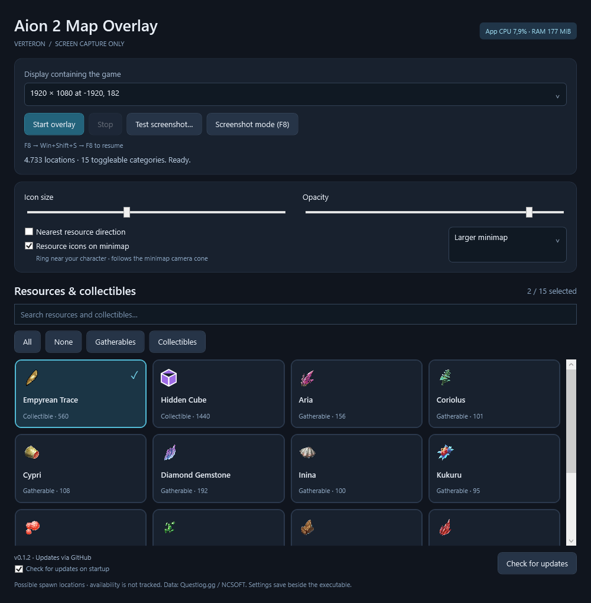

# Aion 2 Map Overlay

Find gatherables and collectibles without switching between the game and a website. The overlay places known spawn locations on your in-game map and follows it as you pan and zoom.

Uses screen capture only. It does not read game memory, capture game network traffic, or send input to the game.

**[Download the portable Windows app](https://github.com/NoRhythmDEV/aion2-map-overlay/releases/latest)**

Extract the ZIP and run `aion2-map-overlay.exe`. On first launch, download the map data from the app, then follow the map calibration prompt. No installer is required.

## Features

- **Resource filters:** Choose from 15 gatherable and collectible categories covering 4,733 Verteron locations.
- **Map overlay:** Icons stay aligned as you pan and zoom, and hide when tracking is lost.
- **Minimap icons:** Selected resources and collectibles appear on the minimap while the full map is closed.
- **Nearest resource direction:** An optional ring near your character points toward the nearest selected gatherable relative to your camera. It reads the minimap view cone and hides when the heading is unclear.
- **Custom appearance:** Adjust icon size and opacity, search categories, and toggle resources with a click.
- **Saved preferences:** Your filters, display, and appearance settings carry over between sessions.
- **Screenshots:** Press **F8**, use **Win+Shift+S**, then press **F8** again to resume tracking.
- **In-app updates:** Check GitHub for new versions and install them without losing your settings or downloaded data.
- **Usage display:** Keep an eye on the app's CPU and RAM use.

Currently supports **Verteron with the English map UI**, at a 16:9 display ratio. Markers show possible spawn locations; live availability and gathering are not detected. Minimap guidance is experimental.

Map data and artwork are downloaded directly from Questlog for local use. Attribution: Questlog.gg / NCSOFT and respective owners.

## Configurator



## Build it yourself

You need **Windows x64**, the **.NET 8 SDK**, and **PowerShell 7**.

```powershell
git clone https://github.com/NoRhythmDEV/aion2-map-overlay.git
cd aion2-map-overlay
dotnet build Aion2MapOverlay.sln -c Release
.\scripts\package-release.ps1
```

The portable ZIP is created in `artifacts/release/`. It includes the .NET runtime; map data downloads through the app on first launch.
